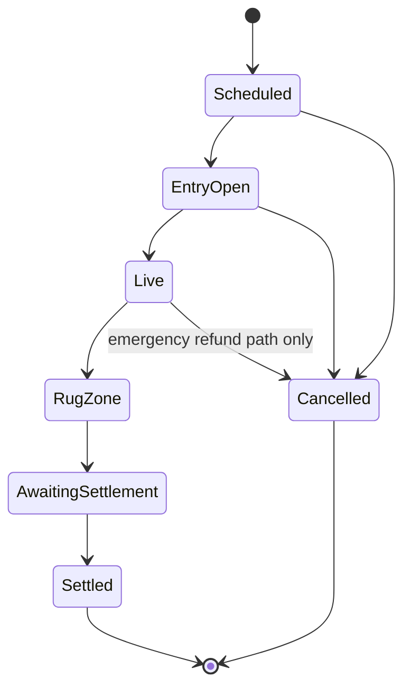

# PRD 02: Game Rules and Economy

Status: Exact prototype specification. Four factions, timer values, `$1` test
interaction, and 50/30/15/5 settlement are selected as configurable simulation
defaults; production economics and Stock Token entry remain unapproved.

## Rule authority

This document defines Last Bell behavior. The historical FoMo3D formulas, keys, masks, teams, airdrop, affiliate logic, and settlement quirks do not apply unless explicitly restated here.

## Player-facing rules

1. Pick one ticker faction.
2. Enter with the required faction asset or test eligibility.
3. Pay the displayed $1 action fee to attempt to take the bell.
4. If the action is accepted, become the holder.
5. Hold the bell when the round reaches zero to win the headline prize.
6. Help the faction accumulate control time for the separate team bonus.

## Prototype constants

| ID | Constant | Prototype value | Status |
|---|---|---:|---|
| `GAME-CFG-001` | Factions per round | 4 | `SELECTED FOR PROTOTYPE` |
| `GAME-CFG-002` | Stock Token entry threshold | $5 equivalent | `PROPOSED` |
| `GAME-CFG-003` | Accepted action fee | 1 USD-equivalent test unit; 1 USDG only in an approved paid mode | `SELECTED FOR PROTOTYPE` |
| `GAME-CFG-004` | Initial soft deadline | 45 seconds after start | `SELECTED FOR PROTOTYPE` |
| `GAME-CFG-005` | Normal accepted-action extension | 2 seconds | `SELECTED FOR PROTOTYPE` |
| `GAME-CFG-006` | Absolute round duration | 180 seconds | `SELECTED FOR PROTOTYPE` |
| `GAME-CFG-007` | Rug Zone duration | final 10 seconds | `SELECTED FOR PROTOTYPE` |
| `GAME-CFG-008` | Snipe threshold | final 2 seconds | `SELECTED FOR PROTOTYPE` |
| `GAME-CFG-009` | Final-holder share | 50% | `SELECTED FOR PROTOTYPE` |
| `GAME-CFG-010` | Winning-faction share | 30% | `SELECTED FOR PROTOTYPE` |
| `GAME-CFG-011` | Next-round seed share | 15% | `SELECTED FOR PROTOTYPE` |
| `GAME-CFG-012` | Operations share | 5% | `SELECTED FOR PROTOTYPE` |
| `GAME-CFG-013` | Per-wallet accepted-claim rate | at most 1 per block | `PROPOSED` |

Constants are immutable for a live round. A future round may use a different approved configuration, but its full configuration must be published before entry opens.

Stage 0 and Stage 1 code must read these values from typed round
configuration. Same-faction theft, late entry, control-time precision, and tie
behavior remain explicit configuration or strategy selections while their open
decisions are evaluated. No UI component may hard-code those unresolved
behaviors.

## Round states



| State | Entry | Claims | Timer extension | Withdrawal | Settlement |
|---|---|---|---|---|---|
| `Scheduled` | No | No | No | N/A | No |
| `EntryOpen` | Yes | No | No | Allowed before live if configured | No |
| `Live` | Configurable late entry | Yes | Yes, subject to rules | No | No |
| `RugZone` | No | Yes | No | No | No |
| `AwaitingSettlement` | No | No | No | No | Anyone may trigger |
| `Settled` | No | No | No | Principal and rewards claimable | Complete |
| `Cancelled` | No | No | No | Refunds claimable | No winner |

Late entry is recommended for growth but remains a product decision. If enabled, faction choice and any required lock must be accepted before the same wallet can claim the bell.

## Timer specification

At round start:

```text
startedAt = accepted round-start timestamp
hardEnd = startedAt + 180 seconds
deadline = startedAt + 45 seconds
rugZoneStarted = false
```

The displayed end is:

```text
effectiveEnd = min(deadline, hardEnd)
remaining = max(effectiveEnd - currentTime, 0)
```

For an otherwise valid accepted claim:

```text
if currentTime >= effectiveEnd:
    reject ROUND_ENDED

if rugZoneStarted:
    do not extend
else if effectiveEnd - currentTime <= 10 seconds:
    rugZoneStarted = true
    do not extend
else if hardEnd - currentTime <= 10 seconds:
    rugZoneStarted = true
    deadline = hardEnd
    do not extend
else:
    deadline = min(deadline + 2 seconds, hardEnd)
```

Requirements:

| ID | Requirement |
|---|---|
| `GAME-001` | No accepted action may move `effectiveEnd` past `hardEnd`. |
| `GAME-002` | Once `rugZoneStarted` becomes true, it can never become false. |
| `GAME-003` | No action in Rug Zone extends the timer. |
| `GAME-004` | The round ends at `effectiveEnd` even if no one submits settlement immediately. |
| `GAME-005` | The winner is determined by the accepted holder at `effectiveEnd`, not by the settlement caller. |
| `GAME-006` | The UI must derive the timer from authoritative round timestamps and correct for local clock drift. |
| `GAME-007` | Rug Zone is time-derived even if no transaction occurs at the boundary; the UI must not wait for a `RugZoneStarted` event to show it. |

The exact use of timestamps versus block-based scoring must be simulated before production. Settlement time must never add post-end control time.

Because a contract cannot autonomously emit at a time boundary, the first state-changing call in Rug Zone may materialize `rugZoneStarted` and emit its event. If no call occurs, the round still ends at the previously published `effectiveEnd`.

## Entry and faction rules

| ID | Requirement |
|---|---|
| `GAME-010` | Every round publishes exactly four faction identifiers before entry. |
| `GAME-011` | A wallet may belong to only one faction per round. |
| `GAME-012` | Accepted faction selection is immutable for that round. |
| `GAME-013` | Deposit size must not increase claim priority, timer extension, final-holder reward, or control-time weight. |
| `GAME-014` | When Stock Token entry is enabled, only canonical allowlisted token addresses may qualify. |
| `GAME-015` | The same token quantity deposited becomes withdrawable after settlement or cancellation. |
| `GAME-016` | The contract and UI must not describe the deposit as fiat-principal protection; token market value can change. |
| `GAME-017` | A stale, inactive, halted, or unsupported asset cannot accept new entries. |
| `GAME-018` | Existing deposited assets remain recoverable if the asset becomes inactive after entry. |

## Claim rules

A claim is the action behind `APE FOR THE BELL`.

Validation order:

1. Round accepts claims.
2. Caller has entered and has a faction.
3. Caller is not the current holder.
4. Caller has not already produced an accepted claim in the same block.
5. Session authorization covers the round, action, fee, and remaining budget.
6. Exactly the configured action fee can be collected.
7. State transition and event emission succeed atomically.

Requirements:

| ID | Requirement |
|---|---|
| `GAME-020` | A rejected claim never charges the $1 game fee. |
| `GAME-021` | The current holder cannot pay to extend their own hold. |
| `GAME-022` | The proposed rules allow a different wallet in the same faction to take the bell. |
| `GAME-023` | Accepted order is canonical chain execution order. |
| `GAME-024` | Gas price, deposit size, previous action count, and faction control do not alter a valid claim's fee or extension. |
| `GAME-025` | The state update, USDG transfer, holder change, timer update, and claim event are atomic. |
| `GAME-026` | If fee transfer or any invariant fails, the entire claim reverts. |
| `GAME-027` | The UI may show `submitted` before acceptance but cannot show the player as holder until the event is observed. |

## Control-time scoring

When a holder loses the bell or the round ends:

```text
intervalStart = holderAcceptedAt
intervalEnd = min(nextHolderAcceptedAt, effectiveEnd)
controlDuration = max(intervalEnd - intervalStart, 0)
```

The duration is credited to:

- The previous holder's personal control total.
- The previous holder's faction control total.

Requirements:

| ID | Requirement |
|---|---|
| `GAME-030` | Clicking or spending more does not directly create control score. |
| `GAME-031` | A holder earns control only for time before another claim or the round end. |
| `GAME-032` | Time after `effectiveEnd` never counts. |
| `GAME-033` | The sum of faction control durations must equal the total time during which the bell had a holder, subject only to documented timestamp granularity. |
| `GAME-034` | A replay must reproduce the same holder intervals and totals as settlement. |
| `GAME-035` | Production launch requires a decision on timestamp precision, zero-duration rapid holds, and deterministic ties. |

Prototype tie-breaker:

1. Greater faction control duration.
2. If equal, the tied faction that most recently acquired the bell.
3. If still equal, lower published faction index.

This tie-breaker is `PROPOSED`.

## Pot accounting

Stock Token deposits and the prize pot are separate accounting domains.

```text
grossPot =
    sponsorSeed
  + carriedSeed
  + sum(successful action fees)
```

The pot must never include:

- Locked Stock Token principal.
- Rejected action fees.
- Wallet gas.
- Unrelated contract balances.

Requirements:

| ID | Requirement |
|---|---|
| `GAME-040` | In paid USDG mode, each accepted action contributes exactly 1 USDG to `grossPot`; testnet mirrors this with a faucet-issued or non-transferable test unit. |
| `GAME-041` | The UI shows whether the pot is sponsored, carried, player-funded, or mixed. |
| `GAME-042` | Pot sources and settlement allocations are reconstructible from events. |
| `GAME-043` | Unallocated rounding dust follows a published deterministic rule. |
| `GAME-044` | No operator withdrawal can touch unsettled player principal or winner allocations. |

Recommended integer allocation order:

```text
finalHolderPool = floor(grossPot * 50 / 100)
factionPool = floor(grossPot * 30 / 100)
nextSeed = floor(grossPot * 15 / 100)
operationsPool = grossPot - finalHolderPool - factionPool - nextSeed
```

Assigning the remainder to operations avoids stranded dust and keeps total accounting exact. This rule is `PROPOSED`.

## Settlement

Anyone may trigger settlement after the effective end.

Settlement:

1. Closes the final holder's control interval at `effectiveEnd`.
2. Selects the control-winning faction.
3. Freezes pot allocations.
4. Makes principal and rewards claimable.
5. Records the next-round seed.
6. Emits the complete result.

No settlement loop may transfer to every participant. Rewards use pull-based claims:

```text
playerFactionReward =
    factionPool * playerControl / winningFactionControl
```

Requirements:

| ID | Requirement |
|---|---|
| `GAME-050` | Settlement is callable by any address. |
| `GAME-051` | The settlement caller receives no gameplay advantage. |
| `GAME-052` | Final-holder reward and faction reward can both accrue to the same player. |
| `GAME-053` | Reward calculations use frozen settlement totals. |
| `GAME-054` | Withdrawals use pull payments and reentrancy-safe accounting. |
| `GAME-055` | A player may withdraw Stock Token principal without claiming a prize in the same transaction. |
| `GAME-056` | A failed recipient transfer does not block other players or round finalization. |
| `GAME-057` | Settlement emits enough data to generate the final receipt without trusting an operator database. |

## Cancellation

Cancellation is exceptional, not a routine operator tool.

| ID | Requirement |
|---|---|
| `GAME-060` | Scheduled or entry-open rounds may be cancelled before play with full principal and fee refunds. |
| `GAME-061` | A live round can be cancelled only through a documented emergency path. |
| `GAME-062` | A cancelled live round has no winner and returns accepted game fees plus principal through pull-based refunds. |
| `GAME-063` | Cancellation emits a reason code and complete refund totals. |
| `GAME-064` | An operator cannot redirect a cancelled pot to itself. |

Whether accepted action fees should always be refundable on a live emergency cancellation is a production decision; the testnet implementation should refund them.

## Economic and game invariants

| ID | Invariant |
|---|---|
| `GAME-INV-001` | `lockedPrincipal >= totalPrincipalWithdrawable`. |
| `GAME-INV-002` | `grossPot = finalHolderPool + factionPool + nextSeed + operationsPool`. |
| `GAME-INV-003` | A wallet cannot be final holder without an accepted claim. |
| `GAME-INV-004` | `effectiveEnd <= hardEnd`. |
| `GAME-INV-005` | Rug Zone never transitions back to normal play. |
| `GAME-INV-006` | No accepted claim occurs at or after `effectiveEnd`. |
| `GAME-INV-007` | No wallet has more than one faction in a round. |
| `GAME-INV-008` | The current holder cannot be the caller of the next accepted claim. |
| `GAME-INV-009` | Principal, pot, rewards, refunds, and operations balances are not double-counted. |
| `GAME-INV-010` | Every displayed final result can be derived from round events and contract state. |

## Open game decisions

| ID | Decision needed |
|---|---|
| `GAME-OPEN-001` | Approve the selected prototype timer constants for production after simulation. |
| `GAME-OPEN-002` | Approve the selected prototype 50/30/15/5 split for production after economic modeling. |
| `GAME-OPEN-003` | Approve the $5 Stock Token entry threshold. |
| `GAME-OPEN-004` | Confirm same-faction bell theft. |
| `GAME-OPEN-005` | Choose timestamp-, block-, or hybrid control scoring. |
| `GAME-OPEN-006` | Approve the faction tie-breaker. |
| `GAME-OPEN-007` | Decide whether late entry is allowed during `Live`. |
| `GAME-OPEN-008` | Define minimum sponsor seed and empty-round handling. |
| `GAME-OPEN-009` | Define whether the operations pool is immediately claimable or timelocked. |
