# PRD 03: Experience and Interface

> `D-020` override: Entry is the first paid ticker claim, Live Studio has four
> one-tap ticker controls, and `THE CLOSING PRINT` replaces faction airtime.
> See [PRD 10](./10-closing-print-market-reactive.md).

Status: Channel 4663 direction is selected. Detailed flows are implementation requirements for MVP-0 and MVP-1.

Visual reference: [complete ImageGen screen gallery](../design/screens/README.md).

## Experience contract

The interface must explain the game before expressing its personality:

> Pick a bag. Pay $1 to steal the bell. Hold it at zero to win 50%.

The faction-control bonus is always described as secondary:

> The ticker with the most airtime splits the 30% team bonus.

## Information hierarchy

The live arena hierarchy is fixed:

1. Primary win condition.
2. Time remaining.
3. Current holder and ticker.
4. Pot and exact action price.
5. Main action.
6. Remaining USDG allowance or action count.
7. Faction airtime bonus.
8. The Trenches activity.
9. Secondary navigation and wallet details.

No chart, mascot, animation, price feed, sponsor, or social element may outrank the first six items.

## Core journeys

### Spectate a live round

Precondition: none.

Flow:

1. Open a live or shared round URL.
2. See the five-second rule, pot, timer, holder, and factions.
3. Watch accepted claims update in canonical order.
4. Open rules or replay without connecting.
5. Optionally choose `ENTER NEXT ROUND`.

Outcome: the spectator understands the state without a wallet prompt.

### Enter a round

Flow:

1. Select `YOUR BAG`.
2. See the $1 action price, reusable $100 play-USDG approval, $10 refresh threshold, gas treatment, and revocation rule.
3. Select `ENTER ROUND`.
4. Approve $100 only if the current allowance is below $10.
5. Receive a confirmed faction and allowance state.

The entry page does not ask the player to choose a maximum spend. The wallet owns the approval decision, and the player may reject, alter, or revoke it.

### Claim the bell

Flow:

1. Player selects `APE FOR THE BELL · $1`.
2. UI immediately enters `submitted`; it does not crown the player.
3. When the canonical event arrives:
   - Accepted: switch current holder and update timer, pot, control, and budget.
   - Rejected: explain the reason and whether any network gas was spent.
4. If another accepted claim follows, show `RUGGED` with the new holder.

### Enter Rug Zone

Flow:

1. Station strip changes to `RUG ZONE`.
2. Persistent copy states `NO EXTENSIONS`.
3. Button changes to `SEND IT FOR THE BELL · $1`.
4. Current holder sees the exact remaining time required to win.
5. A final-two-second accepted transfer receives the `SNIPED` result.

### Settle and claim

Flow:

1. At zero, all action controls disable.
2. UI enters `FINALIZING` until settlement is confirmed.
3. Results show final holder and 50% allocation first.
4. Team airtime result and 30% pool appear second.
5. Player sees each claimable balance separately:
   - Final-holder reward.
   - Faction reward.
   - Stock Token principal.
   - Refund, if applicable.
6. Player may withdraw them independently.

### Share and replay

Flow:

1. Generate a deterministic transmission receipt.
2. Share an image and canonical replay link.
3. Recipient opens the final state before being invited to the next round.
4. Replay allows stepping through accepted claims in order.

## Required screens

| ID | Screen | Requirements |
|---|---|---|
| `UX-001` | Home / next broadcast | Next round, current live round, five-second rules, spectate action, no forced wallet prompt. |
| `UX-002` | Entry / Off Air | Four factions, lock or eligibility explanation, one reusable-approval disclosure, action count, one enter action. |
| `UX-003` | Live / On Air | Rule, pot, countdown, current caller, ticker, airtime, $1 action, remaining allowance, Trenches. |
| `UX-004` | Rug Zone | No-extension state, accepted-order warning, send-it action, exact remaining time. |
| `UX-005` | Finalizing | Frozen zero clock, no winner animation until settlement evidence, readable pending state. |
| `UX-006` | Final transmission | Final holder first, exact reward, faction result second, separate claimable balances. |
| `UX-007` | Replay | Canonical ordered claims, holder intervals, timer changes, final derivation, transaction links. |
| `UX-008` | Receipt | Shareable 4:5 and 9:16 result, plain result plus meme phrase, round and replay identity. |
| `UX-009` | Rules | Human rules, exact constants, pot sources, payout split, contract and asset addresses. |
| `UX-010` | Wallet / session | Current play-token allowance, amount spent, estimated calls, refresh rule, and revoke action. |
| `UX-011` | Supported assets | Canonical address, ticker, status, feed status, entry availability, restriction notice. |
| `UX-012` | Dead Air / incident | Literal failure explanation, fee status, recovery action, status link. |

## Visual screen specifications

These concepts are the implementation-facing visual reference for Channel 4663.
They define composition, hierarchy, visual language, and responsive intent.
Requirement tables and current game constants remain authoritative if
illustrative values inside an image differ from the written PRD.
The generated concepts predate the reusable-allowance decision: any visible
max-spend picker or bounded-session copy in those images is superseded by the
$100 approval, refresh-below-$10, and wallet-revocation requirements above.

### Design-system reference

The reference board locks the Dead Channel palette, broadcast-band grammar,
clipped fields, registration borders, stencil display type, and teletext
utility treatment.

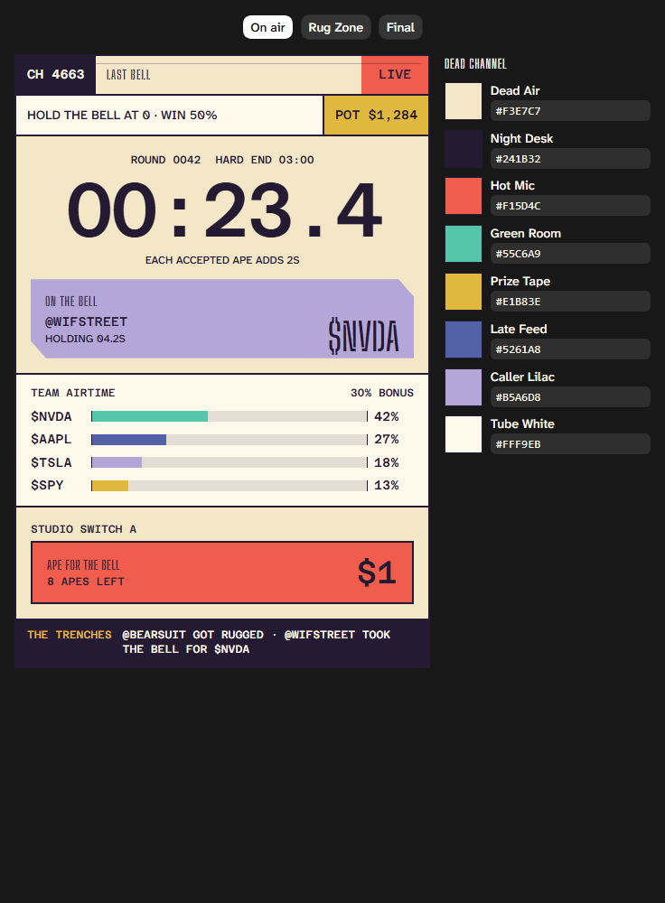

### Complete mobile screen set

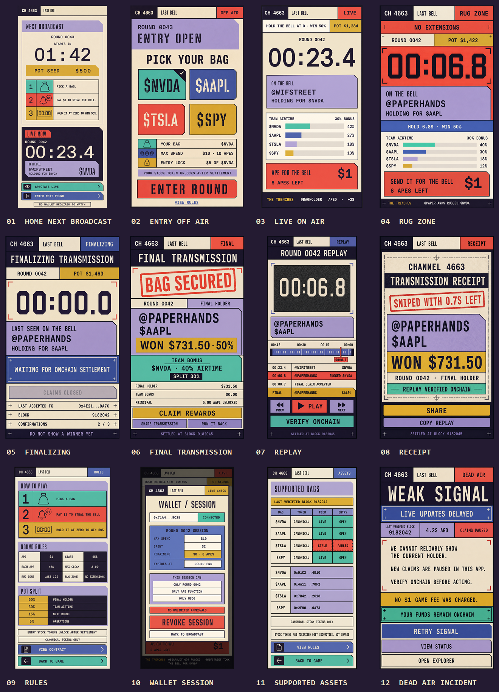

### `UX-001`: Home / Next Broadcast

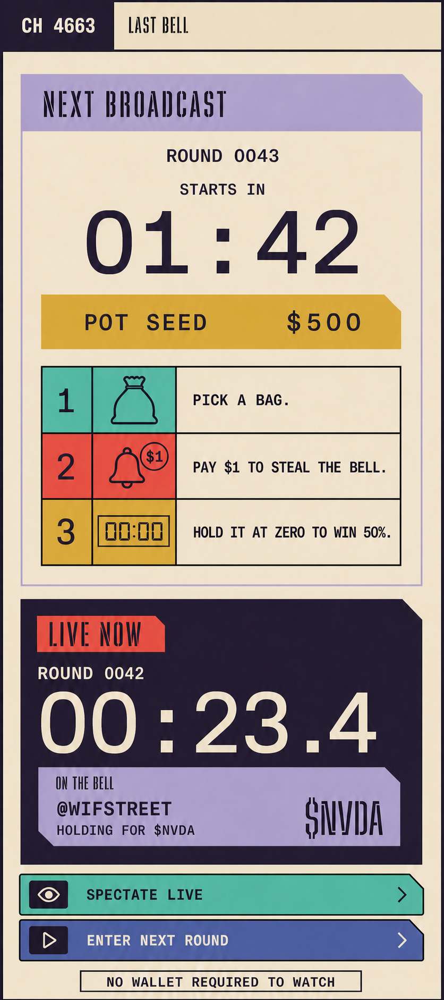

### `UX-002`: Entry / Off Air

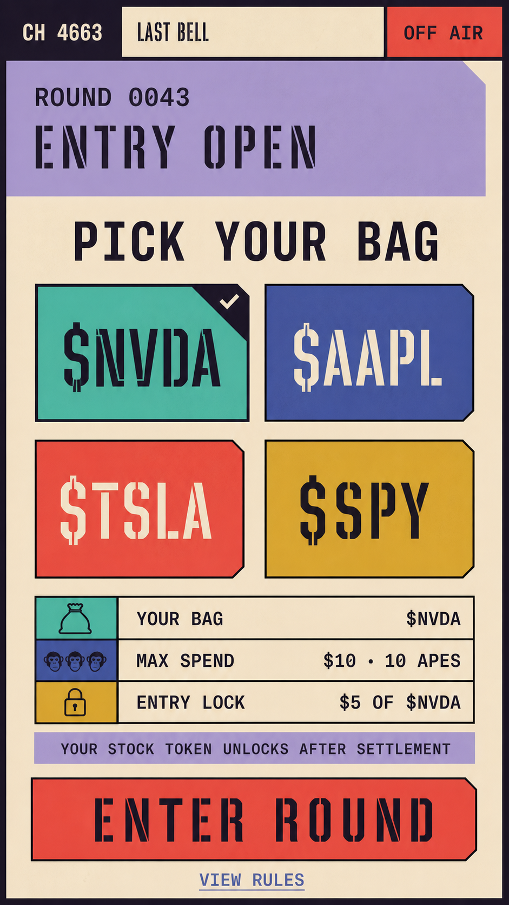

### `UX-003`: Live / On Air

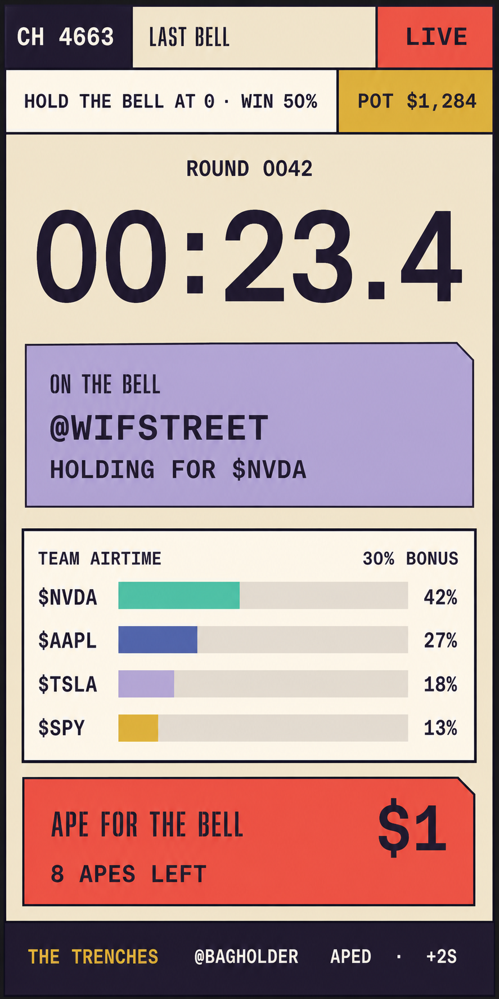

### `UX-004`: Rug Zone

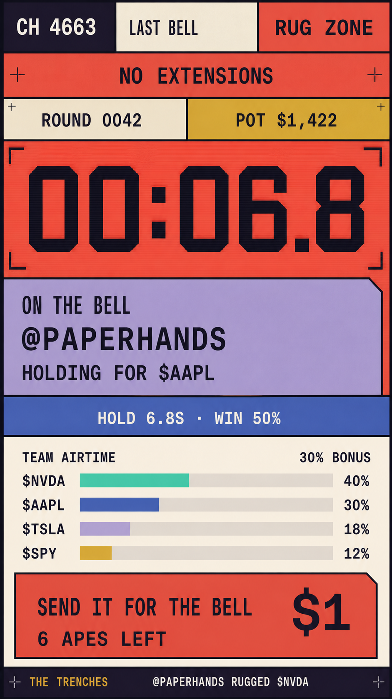

### `UX-005`: Finalizing

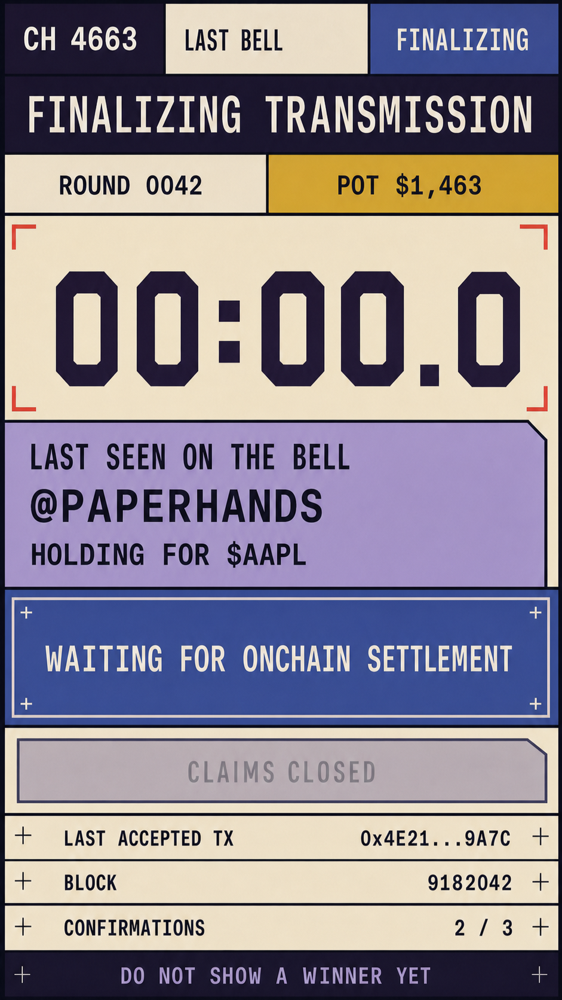

### `UX-006`: Final Transmission

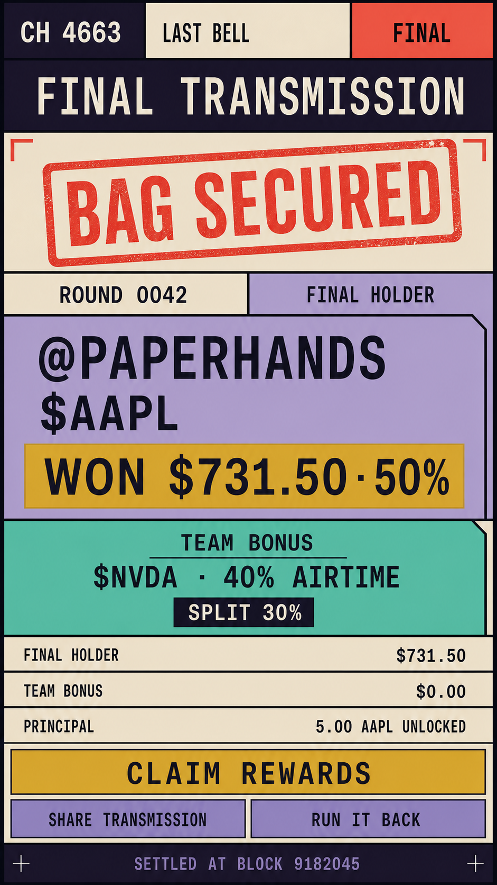

### `UX-007`: Replay

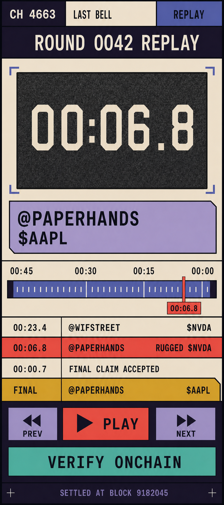

### `UX-008`: Receipt

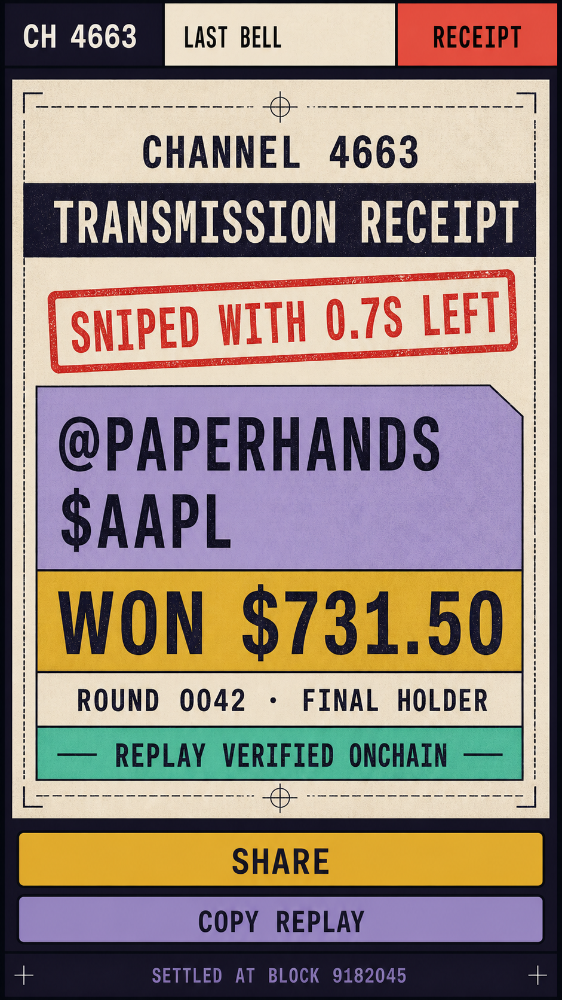

### `UX-009`: Rules

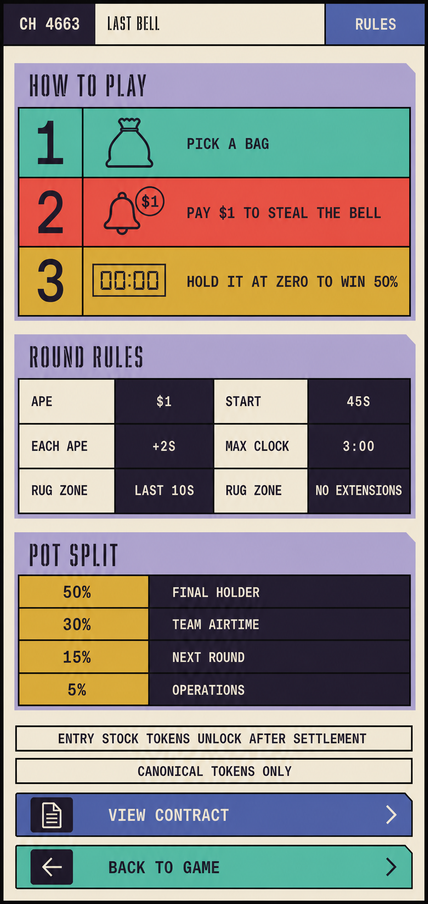

### `UX-010`: Wallet / Session

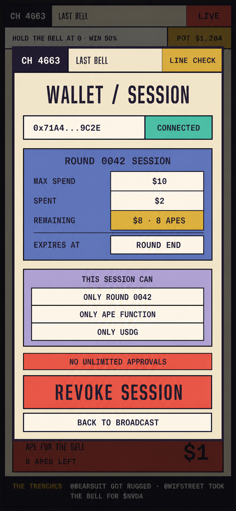

### `UX-011`: Supported Assets

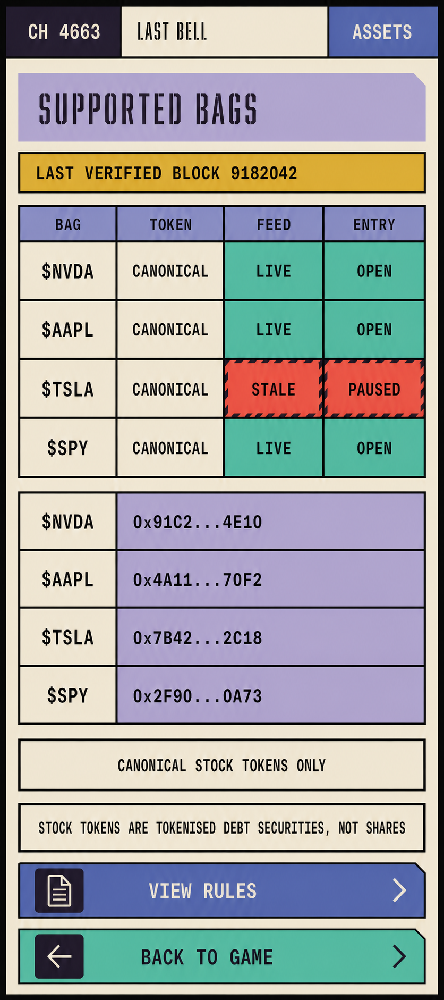

### `UX-012`: Dead Air / Incident

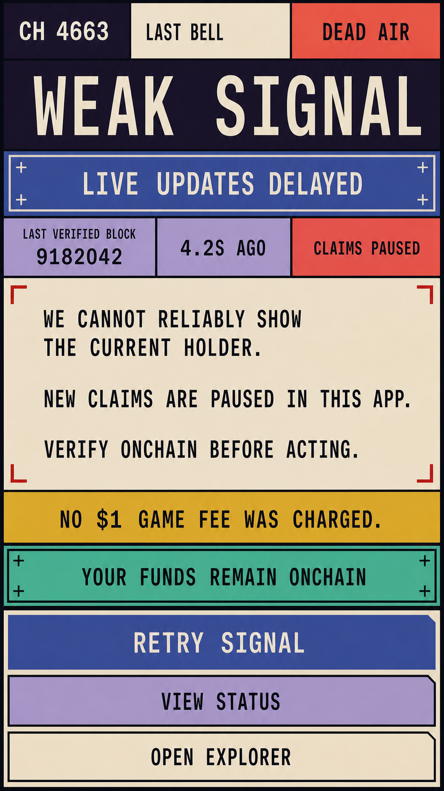

### Desktop Live / On Air

At `1200 px+`, the live arena remains the dominant narrow center broadcast.
Rules and faction airtime occupy the left station-rundown rail. The Trenches,
bounded session state, and secondary navigation occupy the right transmission
rail. The desktop composition must not become a trading dashboard.

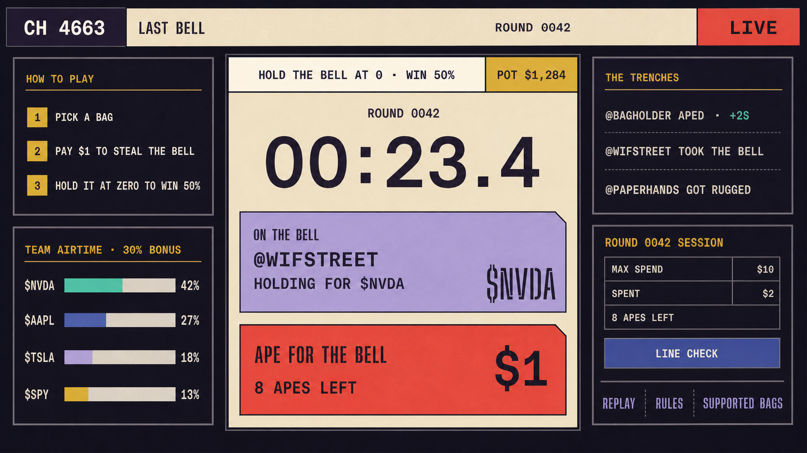

## Visual implementation handoff

The ImageGen concepts define hierarchy, density, visual grammar, and mood. They
are references for implementation, not raster UI assets.

| ID | Requirement |
|---|---|
| `UX-BUILD-001` | Recreate every screen with semantic HTML, CSS Modules, design tokens, and accessible controls; do not ship the concept screenshots as interface layers. |
| `UX-BUILD-002` | Define committed tokens for spacing, border width, clipped-corner geometry, arena width, rail width, type scale, focus treatment, and responsive breakpoints before duplicating layout values across features. |
| `UX-BUILD-003` | Load Big Shoulders Stencil, Atkinson Hyperlegible Next, and Azeret Mono through `next/font`; record source and license information for every shipped font and visual asset. |
| `UX-BUILD-004` | Create original vector icons, faction patterns, and any mascot art; do not trace corporate logos or depend on ImageGen text or icon shapes as production artwork. |
| `UX-BUILD-005` | Define motion duration, easing, interruption, and reduced-motion behavior for holder changes, timer transitions, Rug Zone, finalization, settlement, and incident states. |
| `UX-BUILD-006` | Exact copy comes from typed state and the PRD, not text embedded in a concept image. |
| `UX-BUILD-007` | Each required screen receives mobile and desktop visual-regression coverage at the viewports specified in PRD 06. |
| `UX-BUILD-008` | A component inventory maps repeated station strip, rule band, timer, holder field, action switch, airtime board, Trenches tape, session panel, proof field, and incident notice patterns without turning them into generic rounded cards. |

## Live arena requirements

| ID | Requirement |
|---|---|
| `UX-020` | `HOLD THE BELL AT 0 · WIN 50%` remains visible during live play and Rug Zone. |
| `UX-021` | The countdown is the largest numeric element. |
| `UX-022` | The current holder and ticker never rely on color alone. |
| `UX-023` | The action control includes verb, target, and price: `APE FOR THE BELL · $1`. |
| `UX-024` | Remaining budget is shown as both dollars and actions when the fee is fixed. |
| `UX-025` | Faction state is labeled `TEAM AIRTIME · 30% BONUS`, not as another primary win condition. |
| `UX-026` | The activity feed updates in discrete readable entries and does not continuously scroll essential text. |
| `UX-027` | The UI does not use an optimistic holder state. |
| `UX-028` | Pending action feedback cannot obscure the timer or current canonical holder. |
| `UX-029` | The screen exposes local-data delay or degraded RPC state. |
| `UX-030` | Sound and haptics reinforce state but never carry unique information. |

## Transaction-state language

| Internal state | Broadcast label | Literal explanation |
|---|---|---|
| Ready | `STUDIO SWITCH READY` | `Steal the bell for $1.` |
| Awaiting wallet/session | `LINE CHECK` | `Approve play USDG to enter; you can revoke it any time.` |
| Submitted | `CALL IN PROGRESS` | `Submitted. You do not hold the bell yet.` |
| Accepted | `YOU'RE ON THE BELL` | `Accepted onchain. $1 was added to the pot.` |
| Replaced by another accepted claim | `RUGGED` | `@name stole the bell from you.` |
| Rejected: current holder | `STAY OFF THE LINE` | `You already hold the bell and cannot self-extend.` |
| Rejected: ended | `DEAD AIR` | `The round ended before your action was accepted. No $1 game fee was charged.` |
| Rejected: budget | `BUDGET SPENT` | `Increase the next round's budget; this round authorization cannot exceed its limit.` |
| Rejected: asset/feed | `SIGNAL LOST` | `New entries are paused because the selected asset or feed is unavailable.` |
| RPC degraded | `WEAK SIGNAL` | `Live updates may be delayed. Verify the current holder before acting.` |
| Settlement pending | `FINALIZING TRANSMISSION` | `The clock is final. Waiting for onchain settlement.` |

Copy must remain technically truthful. If gas may still have been spent on a rejected onchain transaction, distinguish network gas from the $1 game fee.

## Channel 4663 requirements

The visual source of truth is `docs/channel-4663-ui-design.md`.

| ID | Requirement |
|---|---|
| `UX-040` | Use the Dead Channel palette and approved text pairings. |
| `UX-041` | Use Big Shoulders Stencil for broadcast display, Atkinson Hyperlegible Next for interface copy, and Azeret Mono for numeric state. |
| `UX-042` | Use broadcast bands and clipped fields rather than a generic card dashboard. |
| `UX-043` | Do not introduce glass, blur, glow, gradients, casino chrome, dark-green fintech, cyberpunk terminal, or shadcn-style card composition. |
| `UX-044` | Channel 4663 is the fictional carrier; `Saved by the Bell` is the product name. |
| `UX-045` | Ticker mascots use awkward flat three-color vector art and do not reproduce corporate logos. |
| `UX-046` | Motion occurs only on meaningful state changes. |
| `UX-047` | Rug Zone uses Late Feed blue and short Hot Mic interruption bars rather than a flashing red takeover. |
| `UX-048` | Final settlement uses a static transmission card; looping celebration is prohibited. |

## Responsive requirements

| ID | Viewport | Requirement |
|---|---|---|
| `UX-050` | 320–767 px | Single broadcast composition; primary action within thumb reach; no horizontal overflow. |
| `UX-051` | 768–1199 px | Portrait arena remains dominant; activity may occupy one adjacent rail. |
| `UX-052` | 1200 px+ | Arena stays narrow; replay, rules, or wallet detail may occupy side rails. |
| `UX-053` | Any width | Desktop never becomes a multi-panel trading dashboard. |
| `UX-054` | Short-height mobile | Pot, clock, holder, action, and remaining budget remain available without losing state; secondary activity may collapse. |

## Accessibility requirements

| ID | Requirement |
|---|---|
| `UX-A11Y-001` | All normal text meets WCAG AA contrast. |
| `UX-A11Y-002` | Factions have ticker text and a pattern in addition to color. |
| `UX-A11Y-003` | All actions work with keyboard and screen-reader input. |
| `UX-A11Y-004` | Focus order follows rule, state, action, budget, secondary information. |
| `UX-A11Y-005` | `prefers-reduced-motion` removes digit rolls, signal tears, and lower-third wipes. |
| `UX-A11Y-006` | Live announcements use restrained ARIA regions; rapid claims cannot overwhelm a screen reader. |
| `UX-A11Y-007` | Timer updates are not announced every visual tick. Announce phase boundaries and meaningful thresholds. |
| `UX-A11Y-008` | Sound is opt-in and captions or text exist for every sound event. |
| `UX-A11Y-009` | Touch targets meet a 44-by-44 CSS-pixel minimum. |
| `UX-A11Y-010` | Zoom to 200% does not remove access to the action, cost, budget, or win condition. |

## Receipt requirements

Every receipt includes:

- Saved by the Bell and Channel 4663 identity.
- Round number and network.
- Exact result.
- Player display name or shortened address.
- Ticker faction and mascot.
- Final-holder or faction outcome.
- Hold time and relevant remaining-time event.
- Pot and prize.
- Canonical replay URL.
- Contract-derived result identifier.

Receipt phrases include:

- `BAG SECURED`
- `SNIPED WITH 0.7S LEFT`
- `YOU GOT RUGGED`
- `LET HIM COOK`
- `ABSOLUTELY COOKED`

`UX-060`: A receipt may be humorous but must not misstate who won, what was paid, or whether a protocol rug occurred.

## UX acceptance

The experience passes design acceptance when:

1. Five first-time-rule questions reach the target in PRD 06.
2. A player can distinguish submitted from accepted without instruction.
3. A player can inspect remaining allowance and round spend throughout the round.
4. A spectator can explain the final-holder and faction awards.
5. A keyboard-only tester can complete entry, play, result review, and withdrawal.
6. A 320-pixel test has no horizontal overflow.
7. Every error contains a literal explanation and recovery action.

## Open UX decisions

| ID | Decision needed |
|---|---|
| `UX-OPEN-001` | Final mascot roster and ticker-to-color mapping for launch season. |
| `UX-OPEN-002` | Whether late entrants see an inline entry drawer or a separate Off Air screen. |
| `UX-OPEN-003` | Whether the Trenches feed is always visible or collapses on short-height devices. |
| `UX-OPEN-004` | Whether player display names exist at MVP or only shortened addresses. |
| `UX-OPEN-005` | Sound and haptic asset production scope. |
