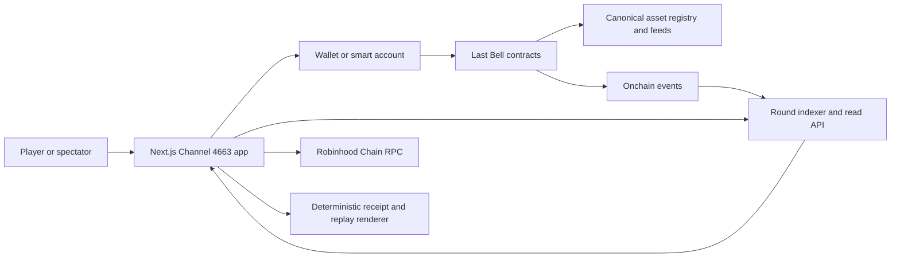

# PRD 04: Technical Product Requirements

Status: Next.js frontend and engineering bootstrap are selected for Stage 0.
Contract, account abstraction, indexing, and value-bearing infrastructure remain
later proposed or open boundaries.

## Technical objectives

| ID | Objective |
|---|---|
| `TECH-001` | Treat canonical chain state as the authority for gameplay and settlement. |
| `TECH-002` | Provide one bounded round authorization followed by one-tap claims. |
| `TECH-003` | Reconstruct every round from contract events. |
| `TECH-004` | Keep principal custody, action-fee accounting, pot allocation, and reward claims independently auditable. |
| `TECH-005` | Prevent frontend or indexer failure from changing the canonical winner. |
| `TECH-006` | Preserve the Channel 4663 system without relying on a pre-skinned component library. |
| `TECH-007` | Support a testnet points mode without requiring value-bearing production contracts. |

## System context



Authority order:

1. Last Bell contract state and canonical events.
2. Confirmed RPC reads.
3. Indexed projection.
4. Browser cache.

The indexer accelerates reads but never decides a winner.

## Frontend stack

Use:

- Next.js 16.2.x App Router.
- Strict TypeScript.
- React Server Components for static, historical, and public data by default.
- Client Components only where live event state, wallet state, or interaction requires them.
- CSS Modules and global custom-property tokens.
- `next/font`.
- `viem` for ABI encoding, reads, writes, logs, and typed event decoding.
- Native CSS transitions and Web Animations API for event motion.

Do not use Tailwind, shadcn/ui, a dashboard template, a canvas renderer for standard controls, or Framer Motion for ordinary transitions.

## Engineering bootstrap

| ID | Requirement |
|---|---|
| `TECH-BOOT-001` | Initialize a Git repository at the project root before application feature work begins. |
| `TECH-BOOT-002` | Use pnpm, commit `pnpm-lock.yaml`, and declare the package manager in `package.json`. |
| `TECH-BOOT-003` | Pin a Next.js-compatible active-LTS Node runtime through committed runtime metadata and enforce it in CI. |
| `TECH-BOOT-004` | Provide scripts for development, production build, typecheck, lint, format check, unit tests, E2E tests, accessibility checks, and visual regression. |
| `TECH-BOOT-005` | Use ESLint and Prettier with committed configuration; formatting or lint failure blocks CI. |
| `TECH-BOOT-006` | Validate environment variables at startup with a typed schema and fail with a literal configuration error. |
| `TECH-BOOT-007` | Use Vitest and React Testing Library for unit and component tests, Playwright for E2E and screenshot regression, and axe-core for automated accessibility checks. |
| `TECH-BOOT-008` | Run typecheck, lint, format check, unit tests, accessibility tests, E2E smoke tests, and visual regression in CI before merge. |
| `TECH-BOOT-009` | The Stage 0 shell and simulator must run without an RPC URL, wallet provider, deployed contract, USDG address, or Stock Token address. |
| `TECH-BOOT-010` | Do not commit secrets or environment-specific production addresses; provide documented example configuration only. |

## Frontend domain model

Define the shared game-domain model before stateful screen components. UI
features consume this model and may not invent screen-local versions of round
or settlement truth.

| ID | Type | Minimum responsibility |
|---|---|---|
| `TECH-DOM-001` | `RoundConfig` | Round ID, factions, action unit and price, timer constants, payout shares, entry mode, scoring strategy, tie strategy, and feature flags. |
| `TECH-DOM-002` | `RoundState` | Phase, authoritative timestamps, effective end, hard end, pot, current holder, current faction, and freshness metadata. |
| `TECH-DOM-003` | `Faction` | Stable faction ID, ticker label, visual pattern, eligibility mode, and cumulative control. |
| `TECH-DOM-004` | `ClaimEvent` | Canonical or simulated order, player, faction, previous holder, accepted time, fee, phase, resulting deadline, and rejection status where applicable. |
| `TECH-DOM-005` | `SessionBudget` | Maximum, spent, remaining, available actions, expiry, scope, and revocation state. |
| `TECH-DOM-006` | `Settlement` | Final holder, winning faction, frozen totals, pool allocations, claimable balances, principal, refunds, and proof identity. |
| `TECH-DOM-007` | `Receipt` | Round and player identity, literal result, approved meme label, replay URL, alt text, and deterministic render inputs. |
| `TECH-DOM-008` | `IncidentState` | Dependency, severity, last verified state, action availability, game-fee status, recovery actions, and public message. |
| `TECH-DOM-009` | `CancellationState` | Reason code, no-winner state, fee refunds, principal recovery, and claim status. |
| `TECH-DOM-010` | `SimulationScenario` | Stable scenario ID, config, initial state, ordered inputs, expected states, and expected final result. |
| `TECH-DOM-011` | Shared serialization | All Stage 0 fixtures and replay inputs are serializable, deterministic, and safe to render in Server Components. |
| `TECH-DOM-012` | Configurable open mechanics | Same-faction theft, late entry, control-time precision, and tie behavior are injected configuration or strategies rather than component conditionals. |

## Prototype route structure

```text
app/
  layout.tsx
  page.tsx
  play/[roundId]/page.tsx
  replay/[roundId]/page.tsx
  receipt/[roundId]/[player]/page.tsx
  receipt/[roundId]/[player]/opengraph-image.tsx
  rules/page.tsx
  supported-assets/page.tsx
  status/page.tsx
  api/rounds/route.ts
  api/rounds/[roundId]/route.ts
  api/status/route.ts
components/
  broadcast/
features/
  arena/
  entry/
  replay/
  receipt/
lib/
  chain/
  game/
  indexer/
  formatting/
styles/
  tokens.css
  globals.css
```

## Rendering boundary

| Surface | Default rendering |
|---|---|
| Home, rules, supported assets | Server |
| Scheduled round shell | Server with revalidation |
| Live arena | Server shell plus Client Component state machine |
| Wallet and session budget | Client |
| Replay | Server initial event list plus optional client stepper |
| Receipt page and Open Graph image | Server |
| Status | Server |

`TECH-010`: Wallet libraries and live subscriptions must not force the entire application into client rendering.

## Contract boundary

Candidate components:

### Round factory or registry

Responsibilities:

- Publish approved implementation version.
- Create rounds with immutable configuration.
- Record round addresses and identifiers.
- Carry an explicitly accounted next-round seed.

### Last Bell round

Responsibilities:

- Faction entry.
- Optional principal lock.
- Claim validation and fee collection.
- Holder and deadline updates.
- Control-time accounting.
- Pot accounting.
- Settlement.
- Pull-based reward, refund, and principal claims.

### Canonical asset adapter

Responsibilities:

- Accept only approved Robinhood registry assets.
- Expose asset active status.
- Resolve the approved price feed for entry-value checks.
- Enforce stale-feed and sequencer checks.

Whether this logic lives in separate contracts or one audited round implementation remains open. Product requirements do not mandate upgradeable proxies.

## Onchain configuration

Every round exposes:

- Round ID.
- Implementation version.
- Four faction IDs and any qualifying asset addresses.
- Action token and exact fee.
- Start time.
- Initial duration.
- Extension duration.
- Hard end.
- Rug Zone threshold.
- Snipe threshold.
- Payout basis points.
- Sponsor and carried seed.
- Late-entry policy.
- Cancellation policy.

`TECH-020`: Configuration cannot change after entry opens except through cancellation.

## Required events

Event names are proposed; semantics are required.

| ID | Event | Required fields |
|---|---|---|
| `TECH-EVT-001` | `RoundConfigured` | round ID, implementation, factions, constants, payout shares, assets |
| `TECH-EVT-002` | `RoundStarted` | round ID, start, deadline, hard end |
| `TECH-EVT-003` | `PlayerEntered` | round ID, player, faction, asset, token amount, entry value snapshot if used |
| `TECH-EVT-004` | `BellClaimed` | round ID, player, faction, fee, accepted timestamp, block, previous holder, deadline, Rug Zone flag |
| `TECH-EVT-005` | `ControlCredited` | round ID, player, faction, interval start, interval end, duration |
| `TECH-EVT-006` | `RugZoneStarted` | round ID, effective end |
| `TECH-EVT-007` | `RoundSettled` | final holder, winning faction, totals, gross pot, all pool allocations |
| `TECH-EVT-008` | `PrincipalClaimed` | round ID, player, asset, amount |
| `TECH-EVT-009` | `RewardClaimed` | round ID, player, reward type, asset, amount |
| `TECH-EVT-010` | `RoundCancelled` | round ID, reason, refundable pot, refundable principal |
| `TECH-EVT-011` | `RefundClaimed` | round ID, player, amount |

Events must support replay and receipts without reading operator-only data.

## Smart-account and session requirements

| ID | Requirement |
|---|---|
| `TECH-030` | Authorization is scoped to one chain, one round, one contract, one action function, one fee token, and one maximum amount. |
| `TECH-031` | Authorization expires no later than round settlement or cancellation. |
| `TECH-032` | The player can view and revoke the active authorization. |
| `TECH-033` | The contract independently enforces the spend limit; UI display is not the only control. |
| `TECH-034` | Unlimited token approval is not the default entry path. |
| `TECH-035` | Session compromise cannot transfer Stock Token principal to an arbitrary destination. |
| `TECH-036` | The UI distinguishes session budget, wallet balance, game fee, and network gas. |
| `TECH-037` | Gas sponsorship failure must degrade to an explained alternative or stop submission before misleading the user. |

Account abstraction, EIP-7702 delegation, ERC-4337, paymaster provider, and session-key library are open implementation decisions.

## Read model and indexing

The indexer stores a derived projection:

```text
Round
  id
  chainId
  contract
  configuration
  phase
  effectiveEnd
  holder
  holderFaction
  pot
  factionControlTotals
  settlement

Participant
  roundId
  address
  faction
  principal
  controlTotal
  claimableBalances

Claim
  roundId
  transactionHash
  logIndex
  blockNumber
  acceptedAt
  player
  faction
  previousHolder
  deadlineAfter
  fee
```

Canonical event identity is `(chainId, transactionHash, logIndex)`.

Requirements:

| ID | Requirement |
|---|---|
| `TECH-040` | Indexing is idempotent and reorg-aware. |
| `TECH-041` | The indexer can rebuild any round from its configured start block. |
| `TECH-042` | The UI exposes index lag and may fall back to direct RPC reads. |
| `TECH-043` | A replay orders events by canonical block, transaction, and log order. |
| `TECH-044` | Derived control totals are continuously compared with contract state. |
| `TECH-045` | A mismatch raises an operator alert and marks derived displays degraded. |

## Live updates

Recommended flow:

1. Load server-rendered round snapshot.
2. Subscribe to contract logs through the selected RPC or indexer stream.
3. Deduplicate by canonical event identity.
4. Reconcile with periodic direct reads.
5. Correct local countdown using authoritative timestamps.
6. Mark connection quality in the arena.

No optimistic holder transition is allowed. Optimistic button depression is allowed if it remains labeled `submitted`.

## Receipt and replay generation

| ID | Requirement |
|---|---|
| `TECH-050` | Receipt inputs are contract/event-derived and deterministic. |
| `TECH-051` | The receipt URL includes round and player identity but no secret or session token. |
| `TECH-052` | Open Graph rendering works without a wallet. |
| `TECH-053` | Replay can verify its indexed projection against a direct contract read. |
| `TECH-054` | Shared media includes plain-text alt content. |
| `TECH-055` | Receipt rendering never delays settlement or withdrawal. |

## Security requirements

| ID | Requirement |
|---|---|
| `TECH-SEC-001` | Use checks-effects-interactions and pull payments. |
| `TECH-SEC-002` | Protect reward and principal claim paths against reentrancy. |
| `TECH-SEC-003` | Separate principal, pot, seed, operations, refunds, and claimed balances. |
| `TECH-SEC-004` | Reject arbitrary ticker-named ERC-20 assets. |
| `TECH-SEC-005` | Validate token transfer behavior; fee-on-transfer or rebasing assets are unsupported unless explicitly modeled. |
| `TECH-SEC-006` | Reject stale feeds and account for sequencer downtime before using a price for new entry. |
| `TECH-SEC-007` | Never apply Robinhood's corporate-action multiplier twice. |
| `TECH-SEC-008` | Protect all privileged changes with least authority, multisig, delay where appropriate, and public events. |
| `TECH-SEC-009` | No privileged function can alter a live round's winner or configuration. |
| `TECH-SEC-010` | Run static analysis, fuzzing, invariant tests, adversarial simulation, and independent audit before value-bearing launch. |
| `TECH-SEC-011` | Frontend supply-chain dependencies and deployed asset integrity are monitored. |
| `TECH-SEC-012` | Client-side receipt and replay data are treated as untrusted until verified. |

## Performance and reliability

| ID | Requirement |
|---|---|
| `TECH-PERF-001` | Mobile largest-contentful paint target is under 2.5 seconds at the 75th percentile on a representative 4G profile. |
| `TECH-PERF-002` | The main action becomes interactive without waiting for receipt or replay code. |
| `TECH-PERF-003` | An observed accepted event updates the arena within one second of delivery to the client. |
| `TECH-PERF-004` | The countdown animation does not trigger a React render every visual frame. |
| `TECH-PERF-005` | The live arena remains usable during indexer degradation through direct RPC fallback or an explicit paused state. |
| `TECH-PERF-006` | Historical and receipt pages remain available if wallet providers are unavailable. |
| `TECH-PERF-007` | A delayed or failed settlement transaction cannot prevent another address from settling. |

## Environment and deployment requirements

- Separate local, testnet, staging, and mainnet configuration.
- Chain IDs and contract addresses loaded from validated configuration.
- No production secret committed to the repository.
- CSP and frame policy appropriate for wallet and receipt behavior.
- Source maps protected according to incident and debugging policy.
- Deployed frontend version and contract implementation version visible on status or rules pages.
- Production deployment requires a reproducible build and artifact provenance.

## Open technical decisions

| ID | Decision needed |
|---|---|
| `TECH-OPEN-001` | Exact Robinhood Chain testnet network and faucet workflow. |
| `TECH-OPEN-002` | Account-abstraction and session-key implementation. |
| `TECH-OPEN-003` | Gas sponsorship or paymaster provider. |
| `TECH-OPEN-004` | Indexer platform versus custom event consumer. |
| `TECH-OPEN-005` | Timestamp, block, or hybrid control-time accounting. |
| `TECH-OPEN-006` | Immutable deployments, clones, or upgradeability model. |
| `TECH-OPEN-007` | Contract decomposition and audit boundary. |
| `TECH-OPEN-008` | USDG canonical address and allowance strategy per environment. |
| `TECH-OPEN-009` | Eligibility attestation interface for later Stock Token mode. |
| `TECH-OPEN-010` | Required chain confirmations and reorg policy for UI, replay, and withdrawals. |
